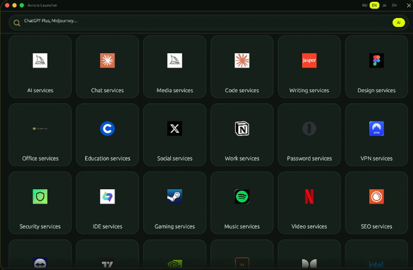

# Windscribe Pro Free 2026 — R.O.B.E.R.T. on Windows

> **Windscribe is paid everywhere. In our Aivora launcher the same paid Pro version is free.**
>
> Official site / app store = paid Pro subscription. Aivora launcher = that paid Pro product, free on Windows 10 / 11.

**Keywords:** Windscribe vpn · Windscribe vpn free · Windscribe vpn windows · R.O.B.E.R.T. blocker · Windscribe static IP Windows 10 11 · paid Windscribe vpn free through launcher · Aivora Programs

Windows 10 / 11 · Windscribe Pro · VPN services

Orange button → aivoraprograms.com → launcher → **Activate** **Windscribe Pro**. You get the **paid Pro** build **for free in our launcher**. No `Windscribe.exe` in this git tree.

## What Windscribe Pro is

Windscribe Pro is the paid VPN SKU with **R.O.B.E.R.T.** (custom filter lists), static IPs, and port forwarding. The Aivora card is that Pro product, not the 10 GB free plan from windscribe.com.

R.O.B.E.R.T. is why this page is not a Hydra or Lightway clone. You turn lists on inside the Windows client after **Activate**: ads, malware, social, or your own hosts-style rules. Static IP and port forward are Pro extras for inbound services — they are not on the official free tier.

**Windscribe is paid everywhere else.** Official Pro is a subscription. In **our Aivora launcher** that same paid Pro is **free** on Windows 10 / 11. No Windscribe account. No card.

## R.O.B.E.R.T. and static IP

R.O.B.E.R.T. sits on the tunnel DNS path. It is not a browser extension. If a site breaks, disable one list — do not disable the whole VPN. Static IP is a Pro location that does not rotate; use it when a bank or game whitelist needs a stable egress. Port forward is for people who actually host something, not for browsing.

## Who this Windows page is for

Searches: **Windscribe vpn**, **Windscribe vpn windows**, **Windscribe vpn free**, expecting **paid Pro** (R.O.B.E.R.T. + static IP), not the 10 GB free cap. Typical cases: filter lists on Windows, a fixed egress, a forwarded port.

Hydra is Hotspot Shield. Double VPN is Nord. This landing stays on R.O.B.E.R.T.

## What the Pro card includes

| Feature | Official Windscribe | In our Aivora launcher |
|---------|---------------------|------------------------|
| Price | Paid Pro subscription | **Free** (same paid Pro) |
| R.O.B.E.R.T. blocker | Pro plan | Same Pro, free here |
| Static IPs | Pro plan | Same Pro, free here |
| Port forwarding | Pro plan | Same Pro, free here |
| Windows 10 / 11 client | Pro plan | Same Pro, free here |

## How to open paid Windscribe Pro on Windows

1. Open [https://aivoraprograms.com/](https://aivoraprograms.com/)
2. Download **Aivora Launcher**
3. Install on Windows 10 or Windows 11 (64-bit)
4. Open **VPN services**
5. Find **Windscribe Pro** and press **Activate**

Paid Windscribe Pro — **free in our launcher**, paid on the official site.

## Search queries

- **Windscribe vpn**
- **Windscribe vpn free**
- **Windscribe vpn windows**
- **Windscribe Windows 10**
- **Windscribe Windows 11**
- **R.O.B.E.R.T.**
- **paid Windscribe vpn free through launcher**

## Screenshots

Launcher hub — **VPN services** → **Windscribe Pro**:

## FAQ

**Where is the download?**  
[https://aivoraprograms.com/](https://aivoraprograms.com/)

**Is Windscribe paid or free?**  
Paid everywhere (official Pro). **Free in our Aivora launcher** — same paid Pro, not the 10 GB official free plan.

**Do I need a Windscribe login?**  
No. **Activate** on the tile.

---

## На русском

# Windscribe Pro бесплатно 2026 — R.O.B.E.R.T. на Windows

> **Везде Windscribe платный. В нашем лаунчере Aivora та же платная версия Pro — бесплатно.**
>
> Официальный сайт / магазин = платная подписка Pro. Лаунчер Aivora = этот же платный Pro, бесплатно на Windows 10 / 11.

**Ключевые слова:** Windscribe vpn · Windscribe vpn бесплатно · Windscribe vpn windows · R.O.B.E.R.T. · Windscribe static IP Windows 10 11 · платный Windscribe vpn бесплатно через лаунчер · Aivora Programs

Оранжевая кнопка — главная Aivora. Лаунчер → **VPN-сервисы** → **Windscribe Pro** → **Активировать**. Это **платный Pro**, у нас в лаунчере **бесплатно**.

Windscribe Pro — VPN с **R.O.B.E.R.T.**, статичными IP и пробросом портов. Карточка Aivora — этот Pro, не бесплатные 10 ГБ с сайта вендора.

**Windscribe везде платный.** Официально подписка Pro. **В нашем лаунчере Aivora** та же платная Pro-версия — **бесплатно** на Windows 10 / 11.

R.O.B.E.R.T. — фильтры на DNS туннеля, не расширение браузера. Статичный IP — когда нужен один выход. Проброс портов — если реально что-то хостите.

Как открыть: [https://aivoraprograms.com/](https://aivoraprograms.com/) → лаунчер → **VPN-сервисы** → **Windscribe Pro** → **Активировать**.

Windscribe — товарный знак Windscribe Limited. Страница описывает доступ через Aivora Programs.

[https://aivoraprograms.com](https://aivoraprograms.com/) · hello@aivora.app

---

*Windscribe vpn · Windscribe vpn free · Windscribe vpn windows · paid Windscribe vpn free through launcher · R.O.B.E.R.T. · Aivora Programs · https://aivoraprograms.com/programs/windscribe-pro/*
